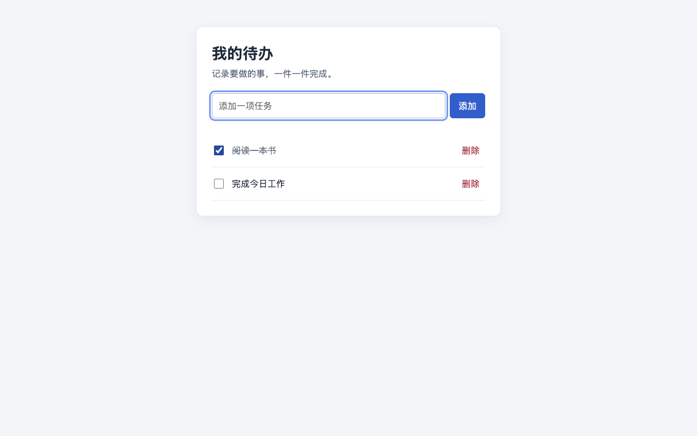

# 简单待办

一个无需安装依赖的待办网页，可以新增、完成和删除任务。

## 效果图



## 启动

下载或克隆仓库后，在项目目录中直接用浏览器打开 `index.html`。也可以在项目目录运行：

```sh
python3 -m http.server 8000
```

然后访问 <http://localhost:8000>。按 `Ctrl+C` 可停止本地服务。

## 使用

1. 在输入框填写任务，点击“添加”或按回车。空白内容不会添加，每项任务最多 200 个字符。
2. 点击任务前的复选框标记完成；再次点击可恢复为待完成。
3. 点击任务右侧的“删除”，即可删除该任务。

任务保存在当前浏览器的本地存储中，刷新页面后仍可查看。同一浏览器使用不同地址（例如直接打开文件和通过本地服务访问）时，数据可能不共享；清除浏览器数据会删除任务。若浏览器禁止本地存储，页面会提示无法保存，刷新后任务可能丢失。
